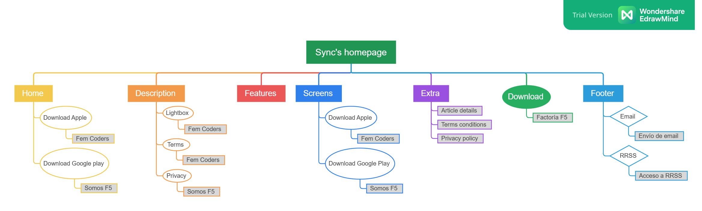

# Personal project 1-replica_web (Sync)

🎯 Main goal: Create a replica of this website: [Sync Template](https://www.elementwebsites.com/templates/sync/) (last updated on August 18, 2025).

## 🚀 Deployment

This project has been deployed on Cloudflare Pages : [replica_sync](https://replica-website-sync.pages.dev/)

## 🗺️ Sitemap

Here you can see the sitemap:



## 🛠️ Installation Guide

Follow these steps to explore the project locally:

1. Clone this repository to your local machine:

   ```bash
   git clone https://github.com/KalypsoDev/replica_web
    ```

1. Open the project folder in Visual Studio Code and install the
   [Live Server extension](https://marketplace.visualstudio.com/items?itemName=ritwickdey.LiveServer)
   if you don’t already have it.

1. Right-click on index.html → "Open with Live Server"
   (or click on the “Go Live” button in VS Code’s status bar).

1. The server will usually start at [port 5500](http://127.0.0.1:5500/).

   - If port 5500 is already in use, Live Server will automatically choose
  another free port (e.g., 5501, 5502, …).

1. You are now ready to start editing this project
   and see your changes update in real time in your web browser.
